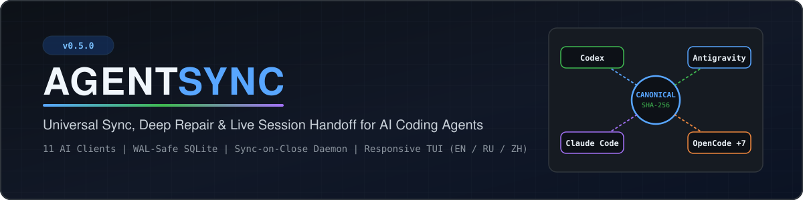
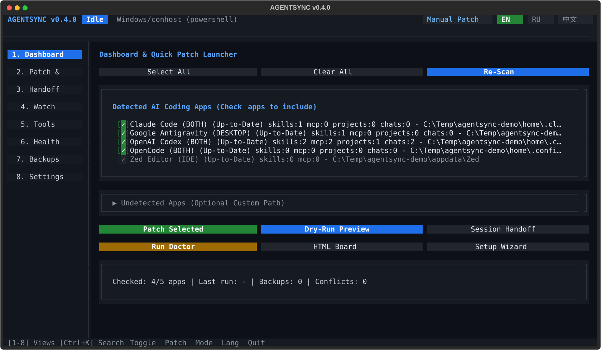
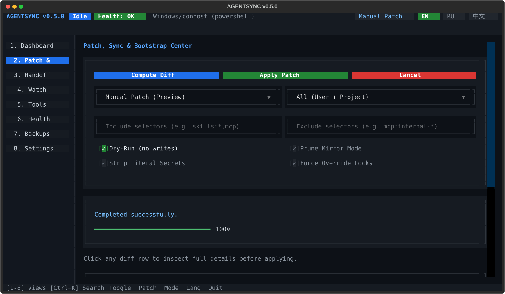
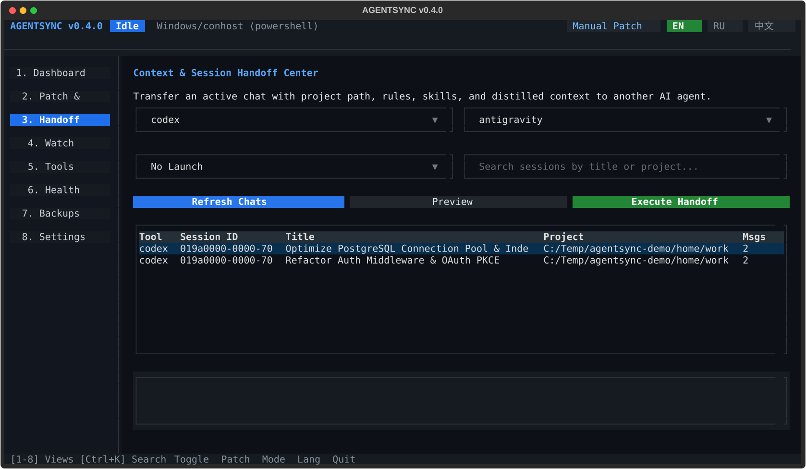
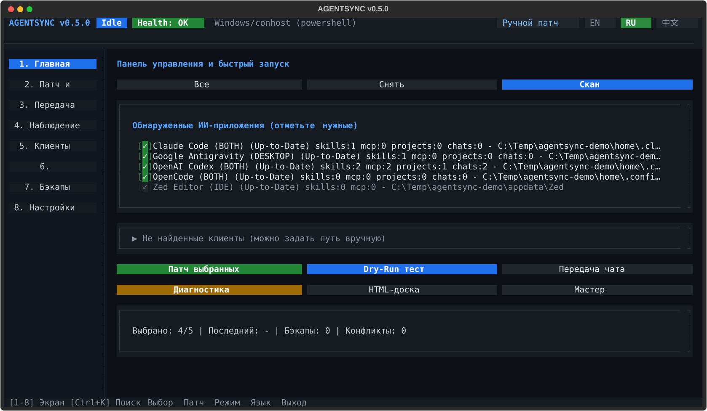
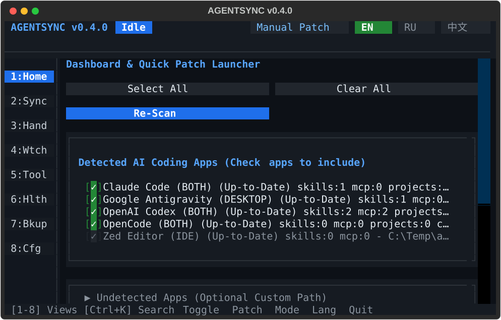

<div align="center">
  
  <br /><br />
  <p>
    <a href="https://github.com/saleqss/agentsync/actions/workflows/ci.yml">
      
    </a>
    <a href="https://github.com/saleqss/agentsync/releases">
      
    </a>
    <a href="https://www.python.org/">
      
    </a>
    <a href="LICENSE">
      
    </a>
    
    
  </p>
  <p>
    <strong>Universal synchronization, deep repair, live session handoff, and unattended Sync-on-Close daemon for 11 AI coding agents.</strong>
  </p>
</div>

---

## Visual Tour

Run `agentsync` in any terminal (`80x24` to ultrawide, Windows Terminal, legacy PowerShell `conhost.exe`, macOS, Linux, or SSH) to open the responsive 8-screen TUI with live **English / Russian / Chinese** switching and a global **`Ctrl+K`** command palette.

<p align="center">
  
</p>

<details>
<summary><strong>More Screenshots: Russian UI, Patch Diff Inspector, Session Handoff, 80x24 Compact Mode &amp; CLI Walkthrough</strong></summary>

### Live Patch & Sync Diff Center


### Context & Session Handoff Center


### Instant Live Localization (Russian / English / Chinese)


### Responsive 80x24 Compact Viewport (Zero Overflow)


### CLI & Sync-on-Close Walkthrough


</details>

---

## Why AgentSync?

Developers rarely use just one AI coding tool anymore. Skills, MCP servers, global/project instructions, workspaces, and active conversations fragment across **OpenAI Codex**, **Google Antigravity**, **Claude Code**, **OpenCode**, **Cursor**, **Zed**, **Windsurf**, and more.

AgentSync solves this without guessing file formats or risking corrupted databases:

- **Zero Silent Writes & Strict Checkbox Isolation:** Only explicitly checked `[x]` tools participate. Unchecked tools are never read, mutated, or touched.
- **WAL/SHM-Safe SQLite Protocol:** Every SQLite mutation (`codex.db`, `state_5.sqlite`, `thread_history_1.sqlite`, `state.vscdb`) takes a verified `sqlite3.Connection.backup()` pre-write snapshot, enforces `PRAGMA busy_timeout=5000`, runs `PRAGMA wal_checkpoint(TRUNCATE)` and `PRAGMA integrity_check`, and rolls back automatically on any anomaly.
- **Complete Process Lock Guard:** Blocks unsafe DB writes while desktop hosts or hidden helpers (`ChatGPT.exe`, `codex.exe`, `extension-host.exe`, `Antigravity.exe`, WebView/runtime workers) hold open handles.
- **Always-On Automatic Verified Backups:** Every mutating command (`sync`, `patch`, `bootstrap`, `repair`, `handoff`, background `watch`) creates a SHA-256 + SQLite-verified snapshot beforehand with automatic retention pruning (`max_backups=20`, `max_backup_days=30`).
- **Native Windowless Daemon (`agentsyncw`), Split-Tier Real-Time Sync & Zero Idle Load:** Run `agentsync autostart enable` once (zero `.vbs`/`wscript.exe`, UTF-16 Task Scheduler XML on Windows with full Unicode/Cyrillic path safety, `launchd` on macOS, `systemd --user` on Linux). Unlocked Tier-1 assets (skills, instructions, plugins, MCP) sync in real time even while apps are open; Tier-2 SQLite/protobuf stores queue safely for **Sync-on-Close** with zero idle polling.
- **Continuous Auto-Diagnostics & Deferred Self-Healing (`repair --on-close`):** Live clickable `[Health]` header pill + persistent `repair_queue.json` automatically heals locked databases and rollouts 2.5 seconds after AI apps exit.
- **Seamless WinError-32-Free Self-Updates:** 6-hour cached release checks with `[Update Now]` / `[Remind Later]` / `[Skip Version]` and a detached Windows PowerShell updater helper that waits for process exit, unifies split installations, refreshes autostart, and restarts the daemon cleanly.
- **Live Session Handoff:** Transfer conversations with project path, rules, and skills across Codex, Antigravity, Claude Code, and OpenCode — verified directly against target native DBs on disk.

---

## Supported AI Coding Clients (11 Adapters)

| Client | Kind | Skills | MCP Servers | Instructions / Rules | Plugins | Projects | Chats / Sessions |
|---|---|:---:|:---:|:---:|:---:|:---:|:---:|
| **OpenAI Codex** (`~/.codex`) | Desktop + CLI | Yes | Yes (TOML) | `AGENTS.md` | Yes | Yes | Full R/W (Rollout v2 + SQLite + `codex.db` catalog) |
| **Google Antigravity** (`~/.gemini`) | Desktop IDE | Yes | Yes (`mcp_config.json`) | `GEMINI.md` / rules | Yes | Yes | Full R/W (Protobuf `.pb` + `state.vscdb`) |
| **Claude Code** (`~/.claude`) | CLI | Yes | Yes (`.claude.json`) | `CLAUDE.md` | Read | Yes | Full R/W (`projects/*.jsonl`) |
| **OpenCode** (`~/.config/opencode`) | Desktop + CLI | Yes | Yes (JSONC) | `AGENTS.md` | - | Yes | Full R/W (SQLite) |
| **DeepSeek Harness** (`~/.dsh`) | Desktop + CLI | Yes | Yes | Project | - | - | Read-Only |
| **Zed Editor** | IDE | - | Yes (`settings.json`) | `.rules` | - | - | - |
| **Gemini CLI** (`~/.gemini`) | CLI | Yes | Yes (`settings.json`) | `GEMINI.md` | - | - | - |
| **Cursor IDE** (`~/.cursor`) | IDE | Yes | Yes (`mcp.json`) | `.cursorrules` | - | - | - |
| **Windsurf IDE** (`~/.codeium/windsurf`) | IDE | Yes | Yes (`mcp_config.json`) | `.windsurfrules` | - | - | - |
| **VS Code Copilot** | IDE | Yes | Yes (`mcp.json`) | `copilot-instructions.md` | - | - | - |
| **Cline** | IDE Ext | - | Yes | `.clinerules` | - | - | - |

---

## Architecture

```mermaid
flowchart LR
    subgraph Clients["Detected AI Coding Clients (Checked [x] Only)"]
        A[OpenAI Codex<br/>TOML + Rollout v2 + 3 SQLite DBs]
        B[Google Antigravity<br/>JSON + Protobuf + state.vscdb]
        C[Claude Code / OpenCode<br/>JSON / JSONC / SQLite]
        D[Cursor / Zed / Windsurf / +5]
    end

    subgraph Guard["Safety & Integrity Layer"]
        P[Complete Process Lock Guard]
        BK[Auto SHA-256 + SQLite Backup<br/>with Retention Pruning]
        TX[WAL-Safe Transactional SQLite<br/>Checkpoint + Integrity Check + Rollback]
    end

    subgraph Core["AgentSync v0.5.0 Core"]
        CAN[Canonical Hub<br/>Skills / MCP / Rules / Projects / Chats]
        REP[Auto-Diagnostics &amp; Self-Healing<br/>Rollouts + DB Recovery + repair --on-close]
        HO[Session Handoff Engine<br/>DB Verification + Hash Dedupe]
        SOC[Split-Tier Daemon agentsyncw<br/>Tier-1 Real-Time + Tier-2 Sync-on-Close]
    end

    Clients <--> Guard
    Guard <--> Core
    Core --> TUI[Responsive 8-Screen TUI<br/>Ctrl+K Palette + Diff Modal]
    Core --> LED[Apply Ledger + Offline HTML Board<br/>+ Portable / Support Bundles]
```



---

## Quick Installation

### Option 1: Install globally with `uv` (Recommended)

```bash
uv tool install git+https://github.com/saleqss/agentsync.git
```

### Option 2: Install globally with `pipx`

```bash
pipx install git+https://github.com/saleqss/agentsync.git
```

### Option 3: Install from source with `pip`

```bash
git clone https://github.com/saleqss/agentsync.git
cd agentsync
python -m pip install -e ".[dev]"
```

Verify installation:

```bash
agentsync --version
agentsync discover
```

---

## Quick Start

### 1. Launch the Interactive TUI

```bash
agentsync
# Or specify language directly:
agentsync --lang ru
agentsync --lang zh
```

Inside the TUI:
- Press **`1`–`8`** to switch screens, **`Ctrl+K`** for the Global Command Palette, **`Space`** to toggle checkboxes, **`P`** to patch checked apps, **`M`** to toggle Auto/Manual mode, **`L`** to switch language live.
- Click any row in the **Patch & Sync** diff table to open the **Diff & Action Inspector Modal**.

### 2. Enable Native Autostart & Background Daemon (`agentsyncw`)

```bash
agentsync autostart enable    # Native windowless logon task (ZERO .vbs/wscript, no admin)
agentsync autostart status    # Verify executable, UTF-16 XML registration & legacy cleanup
agentsync autostart disable   # Remove cleanly anytime

agentsync daemon status       # Live PID, RAM/CPU telemetry, power profile & pending queues
agentsync daemon start|stop|restart|pause|resume
agentsync config list         # Inspect all live settings
agentsync config set power_profile instant   # Hot-reloads running daemon immediately
```

How **Split-Tier Real-Time Sync + Sync-on-Close** works:
1. On OS login, the single-instance `agentsyncw` daemon starts hidden at below-normal priority (`<0.5%` avg CPU, zero idle polling).
2. **Tier 1 (unlocked skills, rules, plugins, MCP configs):** Synchronizes in real time (debounced per Power Profile: `eco`, `instant`, or `battery_safe`) even while Codex or Antigravity is open.
3. **Tier 2 (SQLite DBs, protobuf stores, chat rollouts):** Queues safely while apps hold locks and syncs automatically 2.5 seconds after apps close, preceded by a verified backup.

### 3. Seamless Self-Update (WinError-32-Free)

```bash
agentsync update --check      # Non-blocking GitHub release check (6h cached)
agentsync update              # Stops daemon, hands off cleanly on Windows (zero WinError 32), unifies split installs
```

### 4. Auto-Diagnostics, Deferred Self-Healing & Backups

```bash
agentsync doctor              # Validate SQLite DBs, rollouts, configs, autostart health & split installs
agentsync repair --dry-run    # Preview all auto-repairs without touching disk
agentsync repair              # Quarantine broken rollouts/configs, rebuild Codex hydration & checkpoint WALs
agentsync repair --on-close   # Queue safe repairs to execute automatically 2.5s after locking apps exit

agentsync backup create       # Take an immediate manual SHA-256 + SQLite verified snapshot
agentsync backup verify       # Verify SHA-256 + SQLite PRAGMA integrity_check on all stored backups
agentsync restore <backup_id> # Atomic rollback with automatic -wal/-shm cleanup
```

> **Runtime Engine & Optional Rust Acceleration:** AgentSync includes a clean optional PyO3 boundary (`agentsync.accel`) with built-in high-speed pure-Python hot-path kernels. Set `FAST_ANYTHING_DISABLE=1` or `agentsync config set runtime_engine python` to force pure-Python mode explicitly at any time.

### 5. Portable Profile Bundles & Privacy-Safe Bug Reports

```bash
# Export skills, MCP servers & global rules into a SHA-256 verified zip (secrets redacted to ${ENV_VAR} by default)
agentsync bundle export my-profile.zip
agentsync bundle import my-profile.zip --dry-run
agentsync bundle import my-profile.zip

# Generate an anonymized diagnostics archive (ZERO chats, API keys, tokens, emails, or usernames)
agentsync support-bundle -o diagnostics.zip
```

### 6. Live Session Handoff & Offline Board

```bash
agentsync handoff --from codex --to antigravity --dry-run
agentsync handoff --from codex --to antigravity
agentsync board --open
agentsync list-skills --json
```

---

## Troubleshooting & FAQ

**Q: Why did Codex previously show `disk I/O error` on `codex.db` or infinite loading spinners on synced chats?**  
A: Codex Desktop maintains three WAL-mode SQLite databases (`sqlite/codex.db`, `state_5.sqlite`, `thread_history_1.sqlite`), with almost all live `codex.db` state residing in `codex.db-wal`. Touching files while `ChatGPT.exe` or `extension-host.exe` holds locks — or copying raw files without WAL checkpointing — causes `disk I/O error`. Likewise, threads missing `task_started`/`turn_context`/`item_completed`/`task_complete` events or valid `thread_turns` byte offsets cause the UI hydration spinner to hang. AgentSync v0.4.0 enforces full process-lock guards, WAL-safe transactional snapshots with automatic rollback, 1:1 native thread hydration schemas, and one-command `agentsync repair`.

**Q: Why do some terminal UIs show `?` characters on legacy Windows PowerShell (`conhost.exe`)?**  
A: Legacy `conhost.exe` raster fonts lack Unicode eighth/half-block glyphs (`▁`, `▔`, `▐`, `▌`). AgentSync v0.4.0 automatically detects legacy consoles (`not WT_SESSION`), disables all half-block button borders globally, uses pure ASCII `[X]`/`[ ]` checkboxes, and switches container borders to crisp ASCII automatically.

**Q: How do I regenerate the showcase SVG screenshots in `docs/assets/`?**  
A: Run `python scripts/generate_showcase.py`. It builds a completely synthetic sandbox and captures live Textual screenshots reproducibly with zero personal data.

---

## Development & Testing

```bash
ruff check src tests
pytest -v
python -m build
```

See [CHANGELOG.md](CHANGELOG.md) for the full release history. Released under the [MIT License](LICENSE).
